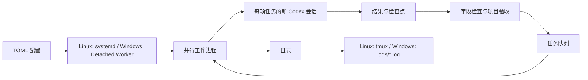

# bkcodex

把 Codex CLI 任务放到后台持续运行，支持 **Linux** 和 **Windows**。适合批量标注、代码开发与维护、材料检查和其他可拆成独立任务的工作。

- **Linux**：后台由 **systemd 用户服务**管理，**tmux** 与 `journalctl` 查看实时进度。关闭 VS Code 或断开 SSH 后，服务器继续执行。
- **Windows**：原生使用脱离后台进程（`DETACHED_PROCESS` + `msvcrt` 文件锁 + Win32 进程树管理），日志自动落盘到 `state_dir/logs/<worker>.log`。

每项任务使用独立会话，已有进度通过文件和检查点接续，账号与会话记录保存在配置目录。运行环境：Linux 或 Windows、Python 3.11+、Codex CLI。Python 运行时仅使用标准库，零第三方依赖。

## 快速开始

### Linux

```bash
git clone https://github.com/sanhui-cloud/bkcodex.git
cd bkcodex
python3 -m venv .venv
. .venv/bin/activate
pip install -e .
cp config.example.toml config.local.toml
```

### Windows (PowerShell)

```powershell
git clone https://github.com/sanhui-cloud/bkcodex.git
cd bkcodex
python -m venv .venv
.\.venv\Scripts\Activate.ps1
pip install -e .
Copy-Item config.example.toml config.local.toml
```

在 `config.local.toml` 中填写项目工作目录、Codex 路径、模型和并发数，然后初始化并检查环境：

```bash
bkcodex init
bkcodex login
bkcodex doctor
```

- `login` 通过 Codex 的设备授权流程登录；凭据由 Codex 管理，存放在配置的 `codex.home` 中。仓库忽略本地配置、凭据、日志和运行记录。
- **Windows 提示**：如果本地已登录 Codex Desktop，也可将 `codex.home` 指向 `~/.codex` 并把 `codex.binary` 指向对应 `codex.exe`（TOML 中建议使用正斜杠 `/`）。`bkcodex init` 不会覆盖已有的 `config.toml`。

提交示例任务并启动：

```bash
bkcodex import examples/tasks.jsonl
bkcodex install
bkcodex start
bkcodex status
```

首次配置 Linux 服务器时，管理员需要启用用户服务的离线运行：

```bash
sudo loginctl enable-linger "$USER"
```

Linux 下 `bkcodex doctor` 的 `linger` 应显示 `yes`；Windows 下 `runtime` 显示 `windows-detached`、`linger` 显示 `not-applicable`。各工作进程会从队列领取不同任务，完成当前任务后继续领取，队列处理完毕后自动退出。

## Agent Skill（供智能体调用）

仓库内置标准 Agent Skill 文件：[skills/bkcodex/SKILL.md](skills/bkcodex/SKILL.md)，方便 **Antigravity、Codex CLI、Claude Code、Cursor、Gemini CLI** 等智能体按规范自动完成任务拆分、入队、启动、巡检、结果验收与失败恢复。

接入方式（按你使用的智能体任选其一，将 `skills/bkcodex` 复制或软链接到对应 skills 目录）：

- **项目级工作区**（推荐团队共享）：复制到项目根目录 `.agents/skills/bkcodex/SKILL.md`
- **Codex CLI 全局**：复制到 `~/.codex/skills/bkcodex/SKILL.md`
- **Claude Code 全局**：复制到 `~/.claude/skills/bkcodex/SKILL.md`
- **Antigravity 全局**：复制到 `~/.gemini/antigravity/skills/bkcodex/SKILL.md`

接入后，直接对智能体说“使用 `bkcodex` 将这些任务拆分并派发到后台 Codex worker 执行与验收”，智能体即会按 Skill 规范自动检查 `doctor`、分配不冲突的文件范围、写 `payload.json`、触发验收并汇报 `result.json`。

## 配置入口

默认读取当前目录的 `config.local.toml`。使用其他配置文件时：

```bash
bkcodex --config /path/to/project.toml status
```

| 配置项 | 用途 |
|---|---|
| `project.name` | 项目名称，用于服务和窗口命名 |
| `project.workspace` | Codex 实际工作的目录 |
| `project.state_dir` | 队列、结果、检查点和运行日志目录 |
| `codex.binary` | Codex CLI 可执行文件路径（Windows 支持 `.exe`/`.cmd` 与反斜杠路径） |
| `codex.home` | 本项目专用的登录与会话目录 |
| `codex.model` | 模型名称，示例为 `gpt-6.1-sol` |
| `codex.reasoning_effort` | 思考强度，示例为 `high` |
| `codex.service_tier` | 服务档位，示例为 `priority` |
| `codex.sandbox` | Codex 文件操作范围，默认 `workspace-write` |
| `codex.writable_dirs` | 额外允许写入的目录 |
| `workers.count` | 同时运行的工作进程数，默认 3 |
| `workers.max_attempts` | 每项任务的执行次数上限，默认 2 |
| `workers.task_timeout_seconds` | 单次任务超时，默认 30 分钟 |
| `workers.max_runtime_hours` | 一批后台工作的时长上限，默认 24 小时 |
| `environment` | 可选代理等环境变量 |
| `validation.command` | 项目自定义验收命令 |
| `validation.timeout_seconds` | 自定义验收命令超时，默认 120 秒 |

模型名称和服务档位以实际账号与 CLI 支持情况为准。可通过 `codex.global_args` 配置当前 CLI 版本需要的全局参数。

## 提交任务

一项任务包含唯一编号、提示词和可选载荷。载荷是供任务使用的 JSON 数据。

```bash
bkcodex enqueue --id job-001 --prompt-file task.md --payload payload.json
```

批量文件每行一项任务，使用 `examples/tasks.jsonl` 的格式。提示词文件路径相对清单目录解析。重复提交相同编号与内容会返回已有任务；内容改变时需要新编号。

每项任务使用新会话，提示词正文原样保留。调度器补充任务文件、结果目录、已有检查点和返回格式。数据标注项目可以在提示词中引用已批准的标注规则。

工作进程把 `result.json` 写到本轮目录：

```json
{
  "task_id": "job-001",
  "status": "completed",
  "summary": "清单已整理。",
  "artifacts": ["checklist.md"]
}
```

`completed` 表示任务返回结果并通过配置的检查。`blocked` 表示执行受阻，`needs_input` 表示需要补充材料或决定。完成状态需要至少一个实际工件（相对路径依次按本轮 `run_dir` 与 `workspace` 解析，且必须落在 `state_dir` 或 `workspace` 内）。

任务结果的专业质量由 `validation.command` 和项目复核流程检查。示例验收脚本为 `examples/validate_markdown.py`。验收命令使用参数数组调用，支持 `{task}`、`{result}` 和 `{run_dir}` 三个占位符。

## 查看、暂停和接续

```bash
bkcodex status
bkcodex logs --name worker-01            # Linux 走 journalctl；Windows 读取 logs/worker-01.log
bkcodex logs --name worker-01 --tail 80 -f  # Windows 实时跟踪日志
tmux attach -t bkcodex-demo-worker-01    # Linux tmux 窗口
```

在 tmux 中按 `Ctrl+b` 再按 `d` 离开。`demo` 对应 `project.name`。

```bash
bkcodex stop          # 当前任务完成后暂停领取
bkcodex stop --now    # 立即终止当前运行中的 worker / Codex 进程树并保存运行记录
bkcodex retry job-001 # 把受阻任务重新放入队列
bkcodex resume        # 清除暂停标记并启动
```

也可直接以前台单 worker 模式运行（队列清空后自动退出，便于被上层智能体或脚本调度）：

```bash
bkcodex worker --name worker-01
```

发生网络错误时，工作进程使用有限重试和共享等待时间。登录失效、额度不足或连续三次失败会使对应工作进程保存退出。修复后可用 `retry` 和 `resume` 接续。进程被强制终止时，已写入磁盘的记录保留；下一次启动读取此前的运行目录。

Linux 下 `install` 写入用户服务，`start` 启动本批任务；Windows 下 `install` 仅初始化目录，`start` 直接拉起脱离后台进程。

## 文件结构

```text
state_dir/
  queue.sqlite                任务、归属和状态记录
  STOP                        暂停标记
  RUN_WINDOW.json             本批运行时限
  NETWORK_COOLDOWN.json        共享网络退避
  workers/                    工作进程状态和独占锁
  logs/                       Windows 后台 worker 日志（<worker>.log）
  runs/<task>/<invocation>/
    task.json                 本次任务与载荷
    instruction.txt           实际提示词
    events.jsonl              Codex 事件流
    stderr.log                CLI 错误记录
    execution.json            退出状态与 token 用量
    final.txt                 最后回复
    result.json               任务返回结果
    receipt.json              检查通过记录
    CHECKPOINT.json           任务按需保存的接续点
  codex-home/                 专用登录与会话记录
```

运行器从 Codex 返回事件中记录 token 用量。美元费用和套餐额度需要结合实际计费规则统计。

## 运行机制



SQLite 事务分配任务，每个工作进程持有独占文件锁（Linux `fcntl` / Windows `msvcrt`）。结果按任务、调用分别保存。代理地址通过配置传入，节点切换由外部代理服务负责。

## 开发与验证

Linux / macOS：

```bash
PYTHONPATH=src python3 -m unittest discover -s tests -v
```

Windows (PowerShell)：

```powershell
$env:PYTHONPATH = "src"; python -m unittest discover -s tests -v
```

测试使用模拟 CLI 检查并发领取、任务恢复、结果验收、超时、停止流程以及跨平台文件锁与 Windows 脱离进程生命周期。GitHub Actions 在 `ubuntu-latest` 与 `windows-latest`（Python 3.11 / 3.13）上自动运行全套测试。

Codex 参数与事件形式参考 [OpenAI 官方非交互运行文档](https://learn.chatgpt.com/docs/non-interactive-mode)。
